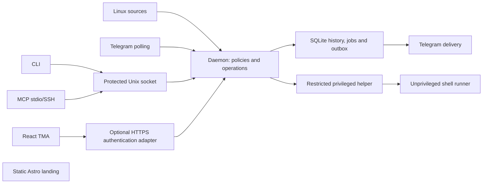

# Architecture / Архитектура

## Статус / Status

Архитектура описывает целевой продукт. В #3 реализованы приватный Telegram `/status`, локальная привязка владельца, выбор языка и ручной systemd-запуск. SQLite/outbox и остальные управляющие интерфейсы следуют по roadmap. Сборка сама по себе не подтверждает runtime-поддержку дистрибутива.

The architecture describes the target product. #3 implements private Telegram `/status`, local owner binding, language selection, and manual systemd startup. SQLite/outbox and the remaining control interfaces follow the roadmap. Compilation alone does not establish distribution runtime support.

## Компоненты / Modules

| Module        | Responsibility / Ответственность                                                                                                                                                                                   | Dependencies / Зависимости                                                                                        |
| ------------- | ------------------------------------------------------------------------------------------------------------------------------------------------------------------------------------------------------------------ | ----------------------------------------------------------------------------------------------------------------- |
| Rust daemon   | Collectors, classification, incidents, policies, SQLite, outbox, Telegram polling; optional TMA backend. / Сбор, классификация, инциденты, политики, SQLite, outbox, Telegram polling; необязательный backend TMA. | Shared contracts; Linux adapters. / Общие контракты; Linux adapters.                                              |
| Rust CLI      | Local control client; future configuration and lifecycle commands. / Локальный клиент управления; будущие настройки и lifecycle.                                                                                   | Daemon socket; separate local administrative flows. / Socket daemon; отдельные локальные административные потоки. |
| Rust MCP      | stdio/SSH adapter with its own identity and scope. / stdio/SSH adapter с отдельной identity и scope.                                                                                                               | Same daemon operations as CLI. / Те же операции daemon, что у CLI.                                                |
| Rust helper   | Typed, bounded privileged operations. / Типизированные ограниченные привилегированные операции.                                                                                                                    | Root-owned policy and OS facilities. / Root-owned policy и средства ОС.                                           |
| React TMA     | Self-hosted UI using the common backend. / Self-hosted UI общего backend.                                                                                                                                          | Generated contracts and shared locales. / Общие локали и производные контракты.                                   |
| Astro landing | Static public information and future synthetic demo entry. / Статическая информация и будущий вход в синтетическое демо.                                                                                           | Shared locales; no server credentials. / Общие локали; без секретов сервера.                                      |
| Integrations  | Portable operational skills and Warp packaging in later tickets. / Переносимые эксплуатационные skills и Warp в следующих тикетах.                                                                                 | Published CLI/MCP contract. / Опубликованный контракт CLI/MCP.                                                    |

Rust application logic stays inside the daemon until another implemented consumer needs extraction. Contracts, entrypoint presentation, and installation configuration are separate libraries because several applications consume them now. Do not create empty core, repository, plugin, or adapter libraries.

Прикладная Rust-логика остаётся в daemon до появления второго реализованного потребителя. Контракты, представление entrypoints и конфигурация установки выделены, поскольку уже имеют несколько потребителей. Пустые библиотеки core, repository, plugin и adapters не создаются.

## Раскладка / Layout

- `apps/`: daemon, cli, helper, mcp, tma, landing.
- `crates/`: contracts and entrypoint support / контракты и поддержка entrypoints.
- `packages/`: derived web contracts and shared locale catalog / производные web-контракты и общий каталог локалей.
- `tools/xtask/`: explicit contract export and consistency checks / явный экспорт контрактов и проверки согласованности.
- `docs/adr/`: accepted decisions / принятые решения.

Cargo and npm own their respective dependency graphs and lockfiles. No Nx, Turbo, remote cache, or independent package-release service is required for this repository size.

Cargo и npm управляют своими графами зависимостей и lockfiles. Текущий размер репозитория не требует Nx, Turbo, remote cache или отдельного сервиса релизов пакетов.

## Потоки данных / Data flow

Collector input becomes a normalized event, then classification/correlation and recipient policies run. A transaction persists history, source progress, and delivery intent before transmission. Delivery is at least once with stable IDs, bounded retry, recipient isolation, and visible dead letters. A broken source changes coverage health.

Данные collector превращаются в событие, проходят классификацию, корреляцию и политики получателей. Транзакция сохраняет историю, прогресс источника и намерение доставки до отправки. Доставка at least once: стабильные ID, ограниченные повторы, изоляция получателей и видимые dead letters. Отказ источника меняет coverage health.

All control interfaces authenticate their caller and construct a trusted context outside request JSON. One application path validates the typed action, checks user/chat/capability/scope, produces an exact preview, obtains required approval, persists the audit, and starts a job. Recheck rights at execution, cancellation, and result retrieval. Resource changes invalidate a stale preview.

Все управляющие интерфейсы подтверждают вызывающего и создают доверенный контекст вне JSON запроса. Единый прикладной путь проверяет действие, user/chat/capability/scope, строит точный preview, получает необходимое подтверждение, сохраняет аудит и запускает job. Права повторно проверяются при исполнении, отмене и выдаче результата. Изменение ресурса делает preview устаревшим.

Dangerous requests require expiring single-use approval and TOTP. Integration mutations require local human approval without expanding the initiating scope. Unknown outcomes enter reconciliation; they are never automatically reported as failed or retried. No mutation proceeds when mandatory audit cannot be persisted.

Опасные запросы требуют ограниченного по времени одноразового подтверждения и TOTP. Изменения от интеграций требуют локального человеческого подтверждения без расширения исходного scope. Неоднозначный результат требует reconciliation; его нельзя автоматически считать отказом или повторять. Недоступный обязательный аудит блокирует изменение.

## Привилегии / Privileges

| Identity   | Allowed / Разрешено                                                                                                                                                                                                              | Forbidden / Запрещено                                                                                                                                                           |
| ---------- | -------------------------------------------------------------------------------------------------------------------------------------------------------------------------------------------------------------------------------- | ------------------------------------------------------------------------------------------------------------------------------------------------------------------------------- |
| daemon     | Own restricted configuration, bot token, SQLite, approved read sources. / Собственные закрытые настройки, bot token, SQLite и разрешённые источники.                                                                             | Arbitrary root execution and Docker socket. / Произвольный root execution и Docker socket.                                                                                      |
| helper     | Authenticate socket peer; independently validate operation and root-owned resource allowlists; use bounded typed OS adapters. / Проверять socket peer, действие, root-owned allowlists; использовать типизированные OS adapters. | Generic root command strings, caller-selected executable, inherited arbitrary environment. / Произвольные root-команды, выбранный клиентом executable и произвольное окружение. |
| runner     | Shell with pipes/redirection under a separate unprivileged user. / Shell с pipes/redirection под отдельным непривилегированным пользователем.                                                                                    | Bot/TOTP secrets, daemon data, Docker socket, sudo, PTY and interactive stdin. / Секреты бота/TOTP, данные daemon, Docker socket, sudo, PTY и интерактивный stdin.              |
| web client | Authenticated, capability-filtered results. / Подтверждённые результаты с проверкой capabilities.                                                                                                                                | Bot token, TOTP secret, direct SQLite/helper access. / Bot token, TOTP secret, прямой доступ к SQLite/helper.                                                                   |

The daemon is a trusted policy authority, not a sandbox against its own compromise. The helper limits privileged effect even when its caller is faulty; it must not treat JSON claims as authorization. Concrete helper IPC, approval persistence, TOTP enrollment, and systemd hardening are implemented and tested in #16. The #3 daemon opens only outgoing Telegram connections; helper/MCP remain scaffolds.

Daemon является доверенным центром политик, а не защитой от собственной компрометации. Helper ограничивает привилегированный эффект даже при ошибке вызывающего; утверждения в JSON не дают полномочий. Конкретные helper IPC, хранение подтверждений, TOTP enrollment и systemd hardening реализуются и проверяются в #16. Daemon #3 открывает только исходящие Telegram connections; helper/MCP остаются каркасом.

## Состояние и ограничения / State and limits

SQLite is the daemon's single-writer store for events, incidents, grants, jobs, action audit, baselines, ingestion progress, and outbox. CLI/MCP/TMA never open it directly. Detailed command output uses bounded installation-owned files referenced by jobs. Future schema migrations must define backup, forward migration, and product-rollback compatibility before release.

SQLite является хранилищем daemon с одним writer: события, инциденты, grants, jobs, action audit, baselines, прогресс чтения и outbox. CLI/MCP/TMA не открывают базу напрямую. Подробный вывод команд хранится в ограниченных файлах установки со ссылками из jobs. Будущие миграции до релиза определяют backup, прямую миграцию и совместимость отката продукта.

Defaults: events/action audit 30 days; detailed process audit 7 days; command output 24 hours. Quotas, backpressure, and visible degraded health bound all growing stores. Full process auditing excludes argv and environment. The basic-profile target is 1 vCPU/512 MiB; full auditing needs separate measurements.

По умолчанию события/action audit хранятся 30 дней, подробный process audit 7 дней, command output 24 часа. Квоты, backpressure и видимая деградация ограничивают растущие хранилища. Полный process audit исключает argv и environment. Цель базового профиля: 1 vCPU/512 MiB; полный аудит измеряется отдельно.

One installation controls one VPS and one bot token. All Telegram requests share the configured existing proxy/VPN route chain; direct fallback is explicit-only. TMA authentication validates Telegram initData server-side. Local enrollment and emergency reset stay local. There is no central SaaS, live PTY, whole-VPS backup, automatic OS rollback, or external watchdog.

Одна установка обслуживает один VPS и bot token. Все Telegram-запросы используют заданную цепочку существующих proxy/VPN; direct fallback включается явно. TMA проверяет Telegram initData на сервере. Enrollment и emergency reset остаются локальными. Центральный SaaS, живой PTY, backup всего VPS, автоматический OS rollback и внешний watchdog не предусмотрены.

## Совместимость / Compatibility

Interfaces and landing target ru, en, zh-Hans, es, pt-BR, hi, ja, ar, he, tr, fr, de; ar/he use RTL. English is the scaffold fallback for unknown locale input. Static landing routes are explicit; unknown routes return 404. Documentation is RU/EN. A translated scaffold banner does not establish complete product localization.

Интерфейсы и лендинг рассчитаны на ru, en, zh-Hans, es, pt-BR, hi, ja, ar, he, tr, fr, de; ar/he используют RTL. Неизвестная локаль в каркасе получает английский fallback. Маршруты статического лендинга явные; неизвестный маршрут возвращает 404. Документация ведётся на RU/EN. Перевод сообщения каркаса не доказывает полную локализацию продукта.

Linux runtime verification belongs to #32: Debian, Ubuntu LTS, Rocky/AlmaLinux, Fedora, Arch, openSUSE; only verified x86_64/ARM64 combinations become supported. Native macOS compilation and Ubuntu CI are separate evidence.

Проверка Linux runtime относится к #32: Debian, Ubuntu LTS, Rocky/AlmaLinux, Fedora, Arch, openSUSE; поддерживаются только проверенные сочетания x86_64/ARM64. Нативная сборка macOS и Ubuntu CI являются отдельными доказательствами.

Shared formats are detailed in [wire contracts](contracts.md). / Общие форматы описаны в [wire-контрактах](contracts.md).

## Initial runtime / Первая установка

#3 stores the local owner in restricted installation configuration; the local CLI binds it. A small private preferences file stores the owner locale. SQLite and durable delivery arrive in #4. Status replies and polling offsets are transient; see [installation and limitations](installation.md).

В #3 владелец хранится в закрытой конфигурации установки и привязывается локальным CLI. Небольшой закрытый файл предпочтений хранит язык владельца. SQLite и сохраняемая доставка добавляются в #4. Ответы на status и polling offsets пока не сохраняются; см. [установку и ограничения](installation.md).
